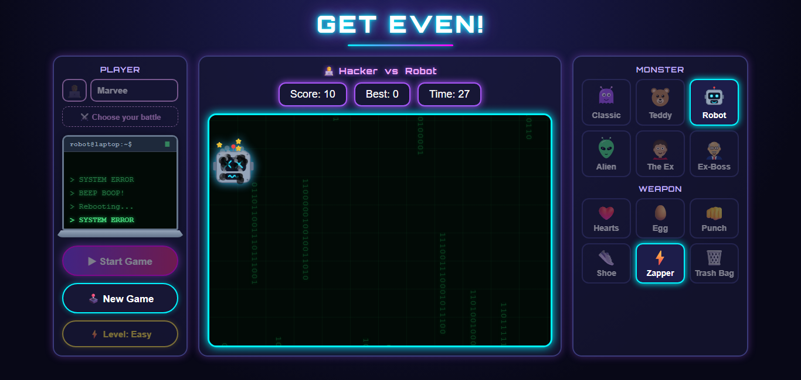
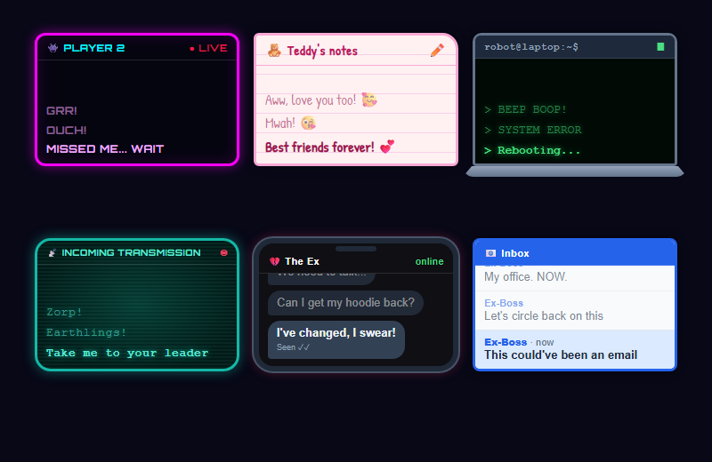
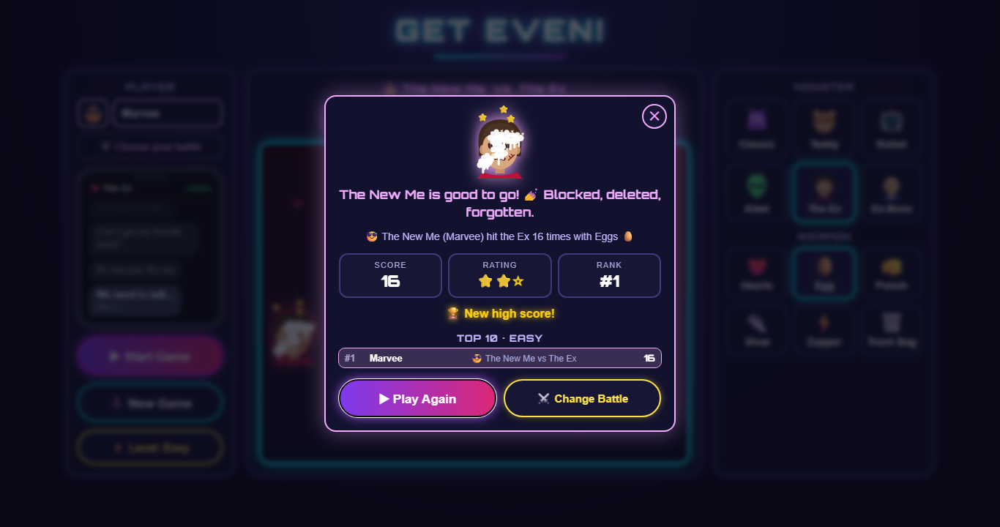

# 👊 Get Even!

**Pick your battle and get even.** A fast, funny browser game: hit the Ex, your Ex-Boss, a robot, an alien or a teddy bear as many times as you can in 30 seconds. They get beaten up, fight back, talk back, and at the end you get a personal verdict and a place on the Top 10.

Built with **plain HTML, CSS and JavaScript**: no framework, no build step, no dependencies, and no image or sound files for the characters or effects. Everything you see and most of what you hear is generated in code.



---

## Contents

- [The idea](#the-idea)
- [How to play](#how-to-play)
- [Features](#features)
- [Technologies](#technologies)
- [Project structure](#project-structure)
- [How the code works](#how-the-code-works)
- [Design decisions](#design-decisions)
- [Accessibility, safety and performance](#accessibility-safety-and-performance)
- [Testing](#testing)
- [Run it locally](#run-it-locally)
- [Known limitations and next steps](#known-limitations-and-next-steps)

---

## The idea

Most "whack-a-mole" games are about reflexes. **Get Even!** adds a story on top: every round is a small, relatable *revenge fantasy* with a character you'd love to get even with, and the game reacts like a comic book.

| You play as | vs | Monster | The joke |
|---|---|---|---|
| 🙂 *your own name* | vs | 👾 Classic | the arcade original |
| 🤗 Best Friend | vs | 🧸 Teddy | hearts make it fall in love, punches make it cry |
| 🧑‍💻 Hacker | vs | 🤖 Robot | "ERROR: FEELINGS DETECTED" |
| 🧑‍🚀 Astronaut | vs | 👽 Alien | "Take me to your leader" |
| 😎 The New Me | vs | 💔 The Ex | "Can I get my hoodie back?" |
| 🧑‍💼 Just Resigned | vs | 👔 Ex-Boss | "This could've been an email" |

The monster **reacts to everything**: its face changes as it takes hits, marks build up on it, it blocks, and it texts you back in a themed message window. The ending is personal too: *"The New Me is good to go! 💅 Blocked, deleted, forgotten."*

---

## How to play

1. **Type your name** in the left box.
2. **Pick a monster and a weapon** in the right box, or press **⚔️ Choose your battle** to pick one of the ready-made matchups above.
3. **Pick a level** with **⚡ Level**: 🟢 Easy, 🟡 Medium or 🔴 Hard. Harder levels mean a smaller monster that blocks more often.
4. Press **▶ Start Game** and hit the monster as many times as you can in **30 seconds**. **🕹️ New Game** stops the round at any time.

Every hit is worth **1 point**, whatever the weapon. The weapons differ in look, sound and the marks they leave, not in score, so high scores stay fair.

---

## Features

### Six weapons, each with its own effect, sound and mark

| Weapon | Comic word | Effect | Sound (synthesized) | Mark left on the monster |
|---|---|---|---|---|
| ❤️ Hearts | MUAH! | kisses and hearts float up | kiss + 4-note melody | 💋 kiss marks |
| 🥚 Egg | SPLAT! | egg-white splash with shell bits | crack-crack-crack + splat | dripping egg white |
| 👊 Punch | POW! | 💥 | crack + deep thud | plaster bandage |
| 👟 Shoe | WHACK! | shoe bounces off | whoosh + slap + "boing" | shoe-sole print |
| ⚡ Zapper | BZZZT! | lightning bolt from the sky | electric buzz + crackles | burn mark with rising smoke |
| 🗑️ Trash Bag | SPLOOSH! | bag bursts: 🍅🥬🧅🥔, stink lines, flies | rustle + splat + plops | squashed tomato / slime |

### Monsters that react
- **Hand-drawn SVG characters** with swappable eyes and mouths, so the **face itself** changes:
  - attacked: normal → shocked → sad with a tear → ✖✖ eyes with orbiting stars → spinning spiral eyes
  - with Hearts: blush → ^^ happy → 😍 heart eyes
  - plus a short flinch or giggle face on every hit
- **They block** every few seconds, and hits during a block show **BLOCKED!** with a metallic clang:
  - Teddy covers its eyes with its paws
  - the Robot flips down a welding mask
  - the Alien raises an energy shield
  - the Ex puts on sunglasses
  - the Ex-Boss hides behind an "IN A MEETING" laptop
  - Classic goes see-through: "BOO!"
- **They talk back** in a message window that fits their world:



### A world for every battle
Each battle has its **own animated background**, which only moves while you play:
- Classic: a retro neon grid
- Teddy: a bedroom at night
- Robot: green code rain
- Alien: deep space with a passing UFO
- The Ex: falling 💔 and "Seen ✓✓" notifications
- Ex-Boss: flying papers and "Reply-all" emails

In the **last 5 seconds** the arena pulses red.

### A personal ending


- a message written for your battle, with one version for a good score and one for a low score
- score, ⭐–⭐⭐⭐ rating (thresholds per level), and your **rank**
- a **Top 10 per level** with name, battle and score; your new entry is highlighted
- the monster exactly as you left it, beaten up or loved up

---

## Technologies

| Area | What is used | Why |
|---|---|---|
| Language | **Vanilla JavaScript (ES2020+)** | no framework needed for one page with one game loop; zero dependencies, nothing to install |
| Graphics | **Inline SVG**, generated from template strings | crisp at any size, face parts can be swapped at runtime, no image files |
| Animation | **CSS keyframes** + the **Web Animations API** (`element.animate`) | CSS for looping and state animations; WAAPI for one-off effects that clean themselves up |
| Sound | **Web Audio API**: oscillators, filtered noise, envelopes, a compressor | every hit sound is synthesized live, so there are no audio files to load and each weapon sounds different |
| Layout | **CSS Grid & Flexbox**, `clamp()`, `min()`, `:has()`, custom properties | three equal-height columns on desktop that stack on phones; theme colours via `--glow`, `--screen`... |
| Popups | native **`<dialog>`** with `showModal()` | built-in focus trapping, Esc to close, `::backdrop` styling, no modal library |
| Persistence | **`localStorage`** (wrapped in `try/catch`) | remembers choices and keeps a Top 10 per level |
| Input | **Pointer Events** (`pointerdown`) | one code path for mouse, touch and pen, and faster than `click` on phones |
| Fonts | Google Fonts: **Orbitron** (neon UI), **Bangers** (comic words), **Patrick Hand** (Teddy's notes) | each one fits a part of the theme |
| Hosting | **Vercel** (static) | push to `main` → live site |

---

## Project structure

```
get_even_game/
├── index.html          # page skeleton: 3 panels, game area, 3 <dialog> popups
├── style.css           # all styling: layout, themes, animations, responsive rules
├── script.js           # all game logic (organized in labelled sections, see below)
├── assets/sounds/      # start.wav, game-over.wav (hit sounds are synthesized;
│                       #   catch.wav is from an earlier version and no longer used)
├── docs/screenshots/   # images used in this README
├── PLAN.md             # the step-by-step development plan with test checklists
└── README.md
```

`script.js` is organized top-down, from **data** to **behaviour**:

| Section | Responsibility |
|---|---|
| **Config** | game constants, levels, weapons, opponents, comic words, game-over messages, backgrounds, message windows |
| **Monster drawings** | one object per monster: SVG body, eye/mouth positions, block item, voice lines |
| **Face parts** | `eyesSVG()` / `mouthSVG()`: build any expression for any monster |
| **Damage marks** | one SVG generator per weapon |
| **Synth sound engine** | `tone()` / `noise()` building blocks plus one recipe per sound |
| **Storage helpers** | safe `load()` / `save()`, the Top 10 board, star rating |
| **State & selection helpers** | score, hits, timers, current choices |
| **Player & battle** | the typed name, ready-made battles, the "vs" line |
| **Monster** | drawing, mood (face) logic, size, movement |
| **Messenger** | the themed reply window in the left box |
| **Background** | building and animating the arena for each battle |
| **Defence** | the blocking schedule |
| **Effects** | projectiles, comic words, bursts, bubbles |
| **Hit handling** | the single `pointerdown` handler |
| **Game flow** | `startGame()`, `endGame()`, `newGame()`, the Game Over popup |
| **Listeners & Init** | wiring the UI together |

---

## How the code works

### 1. Data-driven content
Monsters, weapons, opponents, messages and backgrounds are **plain config objects**. The game logic never contains a list of monsters. Adding a seventh monster means adding one entry to `MONSTERS` (drawing + lines), `OPPONENTS`, `MESSENGERS`, `BACKGROUNDS` and `GAME_OVER_MESSAGES`, plus one card in the HTML.

```js
ex: {
    name: "The Ex", title: "the Ex", glow: "#f43f5e", ink: "#3f1d1d",
    eyes: { l: [40, 50], r: [60, 50], size: 5, style: "human" },
    mouth: [50, 70, 14],
    lines: ["We need to talk...", "It's not you, it's me", "Can I get my hoodie back?"],
    loveLines: ["Don't try to win me back...", "Too late for that 💔"],
    body: `<svg drawing…>`,
    defense: `<sunglasses…>`,
    defenseClass: "from-top",
},
```

### 2. Faces are composed, not stored
Each monster only defines *where* its eyes and mouth go. `faceSVG(monster, { eyes, mouth, blush })` composes any expression (normal, happy, sad, squint, ✖✖, spiral, heart eyes; smile, big, "o", frown, wavy, grit) for any monster. `currentMood()` turns the game state (weapon + number of hits) into a face, and `flinch()` shows a 280 ms reaction before returning to the mood.

### 3. One input handler
All hits go through a **single `pointerdown` listener** on the arena. It checks, in order: is a game running → is the click on the monster (bounding-box test) → is the monster blocking → hit. That keeps the rules in one readable place:

```js
if (!isHit(event))  { smallPuff("💨", x, y); playSound("miss"); return; }
if (defending)      { showBubble("BLOCKED!", x, y, "blocked"); playSound("clang"); return; }
hits++; score++;
playSound(weaponKey); hitEffect(weaponKey, x, y); comicWord(weaponKey, x, y);
showReaction(weaponKey); addMark(weaponKey); flinch(weaponKey); moveMonster();
```

### 4. A timer registry
Every `setTimeout` / `setInterval` (game clock, blocking schedule, flinch, background pop-ups) is stored in one `timers` object, and `clearTimers()` stops them all. **New Game**, **game over** and **Play Again** can never leave a stray timer running.

### 5. Self-cleaning effects
`spawn()` creates an effect element, animates it with the Web Animations API and removes it on `finish`, with a `setTimeout` safety net. However long you play, the DOM doesn't fill up with leftover effect elements.

### 6. Sound from scratch
`tone()` (oscillator + gain envelope, optional pitch sweep and vibrato) and `noise()` (white noise through a biquad filter) are the only building blocks. Each sound is a short "recipe". For example, the egg is three high-pass "cracks" 30 ms apart, then a low-pass "splat" with a falling filter. A **DynamicsCompressor** on the master bus makes the sounds loud without clipping. The `AudioContext` is created on the first click, as browser autoplay rules require.

### 7. Top 10 and ratings
Scores are stored per level as a sorted array in `localStorage` (`board_easy`, ...). `addToBoard()` inserts, sorts (ties keep the earlier score), trims to 10 and returns the new rank. The "Best" score in the header is simply entry #1. Star thresholds live in the `DIFFICULTY` config.

---

## Design decisions

- **No framework.** It's one screen, one game loop and around 1,500 lines of logic. Vanilla JS keeps it dependency-free, instant to load, and easy for anyone to read top to bottom.
- **SVG over images or emoji for the monsters.** Emoji can't change expression. Drawn SVG lets the *same* character look shocked, sad, knocked out or in love, and the marks stick to the character as it moves.
- **Synthesized audio over sound files.** No licensing, no loading, and every weapon gets its own recognisable sound.
- **Equal weapons.** Early versions gave weapons different scores and rules. Playtesting showed this made high scores unfair and the game harder to understand, so weapons are now purely about style.
- **Native `<dialog>`.** It provides accessibility (focus trap, Esc, inert background) for free.
- **Config at the top of the file.** Balancing the game (sizes, blocking frequency, star thresholds, volume) means changing numbers in one place, not hunting through logic.

---

## Accessibility, safety and performance

- **Keyboard:** all choices are real radio buttons styled as cards, with visible `:focus-visible` outlines. Popups are native dialogs.
- **Screen readers:** labelled controls, `role="img"` with an `aria-label` on the monster, and `aria-live` on the message window. Decorative layers are `aria-hidden`.
- **Reduced motion:** `prefers-reduced-motion` turns off background animation, the red pulse and the monster's glide.
- **Safe rendering:** user input (the player's name) is only ever written with `textContent`, never `innerHTML`. `innerHTML` is used only for the game's own SVG templates.
- **Robust storage:** every `localStorage` call is wrapped, so private mode or blocked storage never breaks the game, and corrupted data falls back to defaults.
- **Responsive:** 3 columns on desktop (equal heights), stacked on tablets and phones, no horizontal scrolling, and `touch-action: manipulation` to avoid double-tap zoom.
- **Performance:** animations use `transform` and `opacity` where possible, backgrounds pause when no game is running, and effect elements are removed as soon as they finish.

---

## Testing

The game was built in small steps. Each step in [PLAN.md](PLAN.md) has its own **test checklist**.

During development every change was also checked with **automated browser tests in headless Chrome**: scripted clicks played real rounds and asserted the results. Examples of what they checked:
- scoring, blocking and timers
- the Top 10 and ranks
- battle selection
- leftover effects after many hits
- equal panel heights

Screenshots were taken for visual checks on laptop (1366×650) and phone (375px) sizes. Sound, and how the animations feel in motion, were checked by playing the game.

> The test scripts were used as development tools and are not part of this repository.

---

## Run it locally

No install or build step is needed.

```bash
git clone https://github.com/MarveeMahmood/get_even_game.git
cd get_even_game
```

Then either:
- open `index.html` in a browser, or
- serve the folder: `npx serve .` and open http://localhost:3000. Serving it also lets you test on a phone on the same Wi-Fi.

---

## Known limitations and next steps

- **The Top 10 is local:** it's saved in each player's own browser. A **shared online leaderboard** (e.g. with Vercel KV or Supabase) is the planned next step.
- **One script file:** `script.js` is cleanly sectioned. As the game grows, the natural next step is splitting it into ES modules (`monsters.js`, `sound.js`, `effects.js`, ...).
- **On phones,** the message window sits above the arena, so it can be partly off-screen while playing.
- **Possible additions:** more battles, a combo/streak bonus, a share-your-score card, and an automated test suite in the repository.

---

Made by [Marvee Mahmood](https://github.com/MarveeMahmood).
